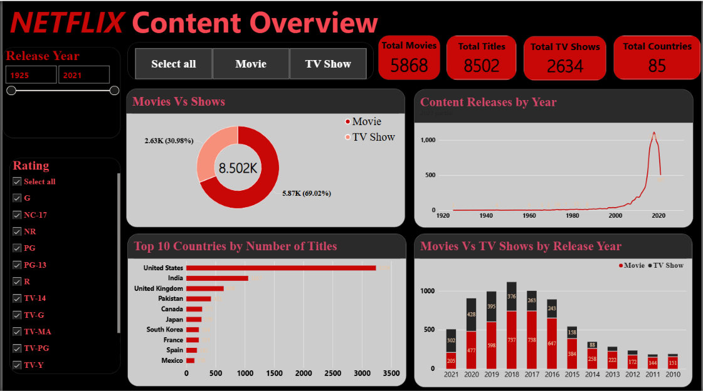

# netflix-powerbi-dashboard
# Netflix Content Analysis Dashboard

An interactive Power BI dashboard analysing Netflix movies and TV shows across countries, years, ratings and categories.

## Tools Used
- Power BI Desktop
- DAX
- Data modelling

## Dashboard Pages

### 1. Content Overview

### 2. Global Content Insights

### 3. Content Growth and Trend Analysis

### 4. Audience and Category Intelligence

### 5. Executive Recommendations

## Key Insights
- Netflix has 8,502 titles: 69% movies and 31% TV shows
- The United States has the most titles, followed by India and the UK
- Content releases peaked around 2018

## Files
- `Netflix's.pbix`: Power BI report
- `Dataset.csv`: source data
